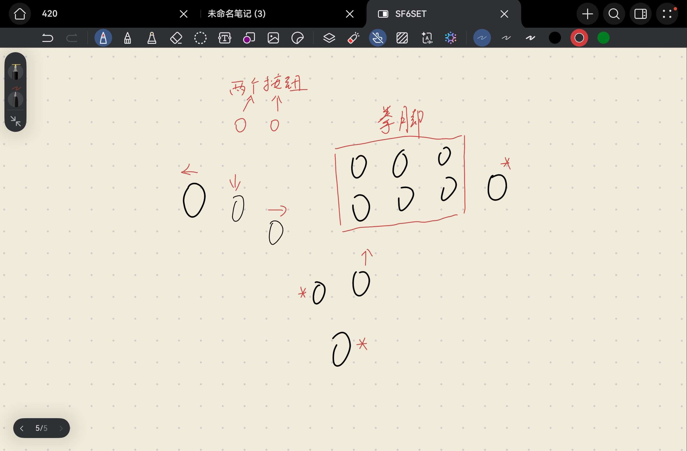

# HITBOX 布局与当前现状

最近核对日期：2026-10-15。

本文记录正在使用的设备现状。信息来源为用户当日确认、所附布局图和当前源码分析。2026-10-15 已将原 `SF6/main.c` 拆分为 Board、Core、Profiles 模块，现用行为经旧版本对照检查保持一致。历史设计说明与本文冲突时，不得据历史说明擅自更改当前设置。

## 用户已确认

- 当前设置正在实际使用。
- 实际主频、按键电平和输出时序没有问题。这是用户使用确认，本次未进行仪器测量或硬件烧录。
- 实际可用的自定义按键只有 **4 个**。
- 此外还有 **2 个金属按钮**；其用途和是否可重新分配尚未明确，不能直接当作额外两个宏按键。
- 不应把源码中的所有宏名称理解为设备上各有一个独立实体按钮。

## 当前布局

图片为用户提供的布局草图，用于识别相对位置，不表示尺寸或电气接线。

| 区域 | 图片可见布局 | 确认范围 |
| --- | --- | --- |
| 左侧方向区 | 左、下、右三个按钮斜向排列 | 箭头标注清楚 |
| 下方方向键 | 上方向按钮位于拳脚区下方 | 箭头标注清楚 |
| 右上拳脚区 | 六个按钮，两排、每排三个 | 标为“拳脚”；图中未逐一标明轻中重及具体键位 |
| 上方小按钮 | 两个小圆圈并排 | 用户说明另有两个金属按钮，按此记录；具体功能未明确 |
| 星号位置一 | 六键拳脚区右侧 | 一个星号按钮 |
| 星号位置二 | 上方向键左下附近 | 一个星号按钮 |
| 星号位置三 | 上方向键更下方 | 一个星号按钮 |
| 第四个自定义按键 | 图中未能明确定位 | 数量以用户确认的四个为准，不因只辨认到三个星号而改为三个 |

四个自定义按键与两个金属按钮的具体功能、引脚对应关系尚未由用户逐一提供；不从图中猜测。后续需要分配功能时再补充，不影响记录当前可正常使用的状态。

## 当前源码行为（不是实体接线确认）

下表由 `SF6/Board/board_io.c` 的 `ReadInputs()`、`SF6/Core/input_bindings.h` 和 `SF6/Core/controller_logic.c` 的 `Logic_Process()` 推导。实体按钮与引脚的对应关系不能仅凭源码确定。

| 输入引脚 | 当前源码用途 |
| --- | --- |
| PB1 / PB3 | 下 / 右 |
| PB4～PB9 | LP、MP、HP、LK、MK、HK 六个拳脚输入 |
| PB10（IN_SUPER） | 左方向，同时参与宏动作分支选择 |
| PB11（IN_SP1） | 按下沿触发 SUPER |
| PB12（IN_SP2） | 上方向 |
| PB14（IN_SP4） | 宏方向镜像 |
| PB15（IN_X） | 轻拳＋轻脚 |
| PA10（IN_COMBO1） | 中拳＋中脚 |
| PB0、PB2、PB13、PA11、PA12 | 当前读取但没有对应有效输出用途 |
| PA13 | 当前未实现 LA1 输入读取 |

源码结构保留 `GPIO_Init_All()` → `ReadInputs()` → `Logic_Process(in)` → `Output_Update(out)`，由 SysTick 节拍驱动；目标 72 MHz 下约 60 FPS，PA0～PA9 为开漏输出。

当前实现细节：

- `QUEUE_LEN = 4`，环形队列最多等待三个动作，另有一个当前执行动作。
- `MAX_FRAMES = 4`，普通 SP 动作分支为四帧；SUPER 实际执行八帧。
- SP1～SP4 的按键状态目前不更新（重构前对应调用被注释），保留的动作表不代表实体按键可触发这些功能。
- `HOLD_THRESHOLD = 10` 仍保留；现有按下沿入队条件不能触发相应长按分支。
- 宏执行期间直接返回宏输出，不叠加普通按键；镜像状态每帧读取。
- SUPER 无方向选择时 `dir = 3`，对应出招表是八帧空输出，保留重构前没有匹配分支时的行为。

出招数据现集中在 `SF6/Profiles/current_profile.c`，结构及后续扩展方式见 [代码结构与扩展指南](代码结构与扩展指南.md)。本次仅为结构重构，未增加可用实体按键、未启用角色切换，也未改变当前动作。

上述内容用于理解当前实现，不将历史设计差异自动列为必须修复的使用故障。只有用户提出相关功能需求或出现具体异常时，再按需求定位和修改。

## 历史说明的适用范围

- `AGENTS.md` 中旧输入映射、触发规则和动作表是历史设计参考，不是当前硬件接线证明。
- `SF6/jb6.docx` 是接线表和历史代码记录，未经最新核对的内容不得覆盖当前用户确认。
- 先前分析中“实际主频、按键电平和输出时序仍需上板验证”的表述，现已由用户使用确认更新；如未来改动相关配置，才需对受影响部分重新验证。
- 先前 README 中“部分宏触发和输出行为仍需修复”的笼统结论已撤回，改为记录实际实现与历史设计的差异。

## 后续维护

每次项目工作先读本文。涉及布局、接线、按键数量、用途、宏逻辑或时序变化时，同步检查本文、README 与 AGENTS.md，更新受影响内容、信息来源和核对日期。保留仍有效的用户确认；未知事项继续标明未知，不猜测补全。

| 日期 | 更新 |
| --- | --- |
| 2026-10-15 | 首次记录当前布局图、四个可用自定义按键和两个金属按钮；记录当前设置使用正常的确认；区分历史约定、源码行为与未知接线 |
| 2026-10-15 | 模块化重构后更新源码路径和描述；Keil 编译及旧版行为回归通过，未烧录，保留用户对现用设置的确认 |
| 2026-10-15 | 用户确认迁移至桌面 GITKU；修复编译依赖版本冲突，完整重编译 0 错误、0 警告。固件源码、输入和逐帧输出未修改，未烧录，保留现用硬件确认；本次未重跑电脑端回归 |
